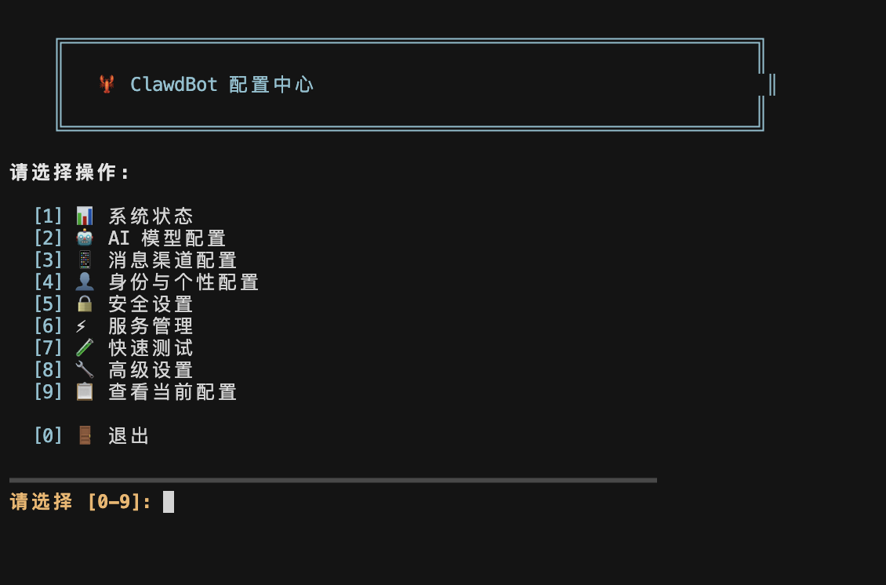
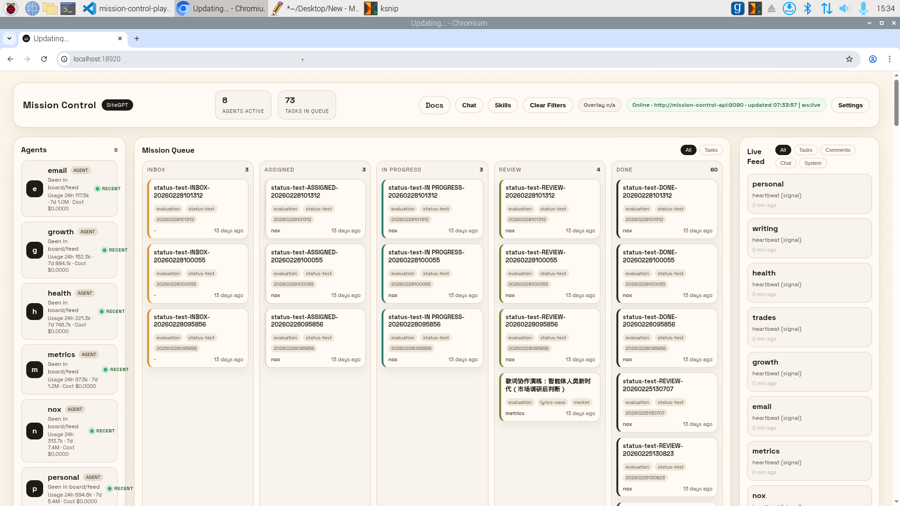
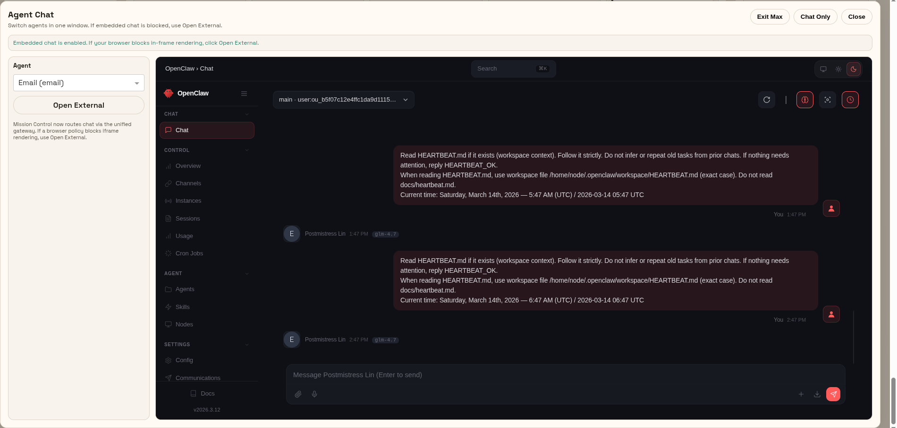

# OpenClaw-PWTInstaller

<p align="center">
  
  
  
</p>

> 把 OpenClaw 从“单个助手”升级为可长期运行、可观测、可治理的个人 AI 基础设施。

<p align="center">
  
</p>

## 这是什么

这个仓库提供三件事：

- 单 Agent 命令行安装器，适合先把 OpenClaw 跑起来。
- 8-Agent Panopticon 编排，适合长期运行多角色 Agent。
- Mission Control 控制台与 API，适合统一观察、治理和扩展整套系统。

如果你第一次接触 OpenClaw，先用“单 Agent”；如果你的目标是 PWT、多 Agent 长时运行或 Mission Control，看“Panopticon 主路线”。

## 个人 AI 基础设施全景

可以把这套系统理解成 4 层，从“先跑起来”一路扩到“长期运行 + 可治理 + 可追溯”：

| 层 | 解决什么问题 | 仓库位置 | 何时需要 |
| --- | --- | --- | --- |
| 接入与配置层 | 把模型、渠道、插件和本地配置接进来 | [install.sh](install.sh)、[config-menu.sh](config-menu.sh)、[docs/openclaw-json-guide-zh-cn.md](docs/openclaw-json-guide-zh-cn.md) | 第一次把 OpenClaw 跑起来时 |
| Agent 运行层 | 让多个角色长期分工、隔离运行 | [panopticon/](panopticon/) | 需要 PWT、多 Agent 编排或长期运行时 |
| 控制面 | 提供统一入口、状态观察、聊天代理、任务与事件流 | [MissionControl/](MissionControl/)、[mission_control_api/](mission_control_api/) | 需要统一观察、治理或二次开发时 |
| 知识治理层 | 让资料导入、切片、OCR、policy、resolve 和审计形成闭环 | [mission_control_api/](mission_control_api/)、[docs/knowledge-system-playbook-zh-cn.md](docs/knowledge-system-playbook-zh-cn.md) | 需要把资料处理做成可追溯系统时 |

最常见的组合只有三种：

- 只想先用起来：先做接入与配置层，用单 Agent 路线。
- 想长期跑 8 个角色：接入与配置层 + Agent 运行层 + 控制面。
- 想把资料治理也接上：四层全部用上。

## 先选路径

| 路线 | 适合谁 | 入口 | 状态 |
| --- | --- | --- | --- |
| 单 Agent 命令行 | 先跑通模型和消息渠道 | [install.sh](install.sh) | 稳定、轻量 |
| 8-Agent Panopticon | 长期运行、分工协作、统一治理 | [panopticon/README.md](panopticon/README.md) | 当前主路线 |
| Mission Control 二次开发 | 想改控制台、事件流、知识系统 | [mission_control_api/README.md](mission_control_api/README.md) | 已集成进主路线 |
| 根目录单容器 Docker | 本地临时实验 | [docker-compose.yml](docker-compose.yml) | 实验性，不建议作为默认部署 |

## 5 分钟上手

### 路线 A：单 Agent

```bash
git clone https://github.com/Ieer/OpenClaw-PWTInstaller.git
cd OpenClaw-PWTInstaller
chmod +x install.sh config-menu.sh
./install.sh --preflight
./install.sh
```

安装完成后建议立即验证：

```bash
openclaw models status
openclaw health
openclaw dashboard --no-open
```

### 路线 B：8-Agent Panopticon

```bash
git clone https://github.com/Ieer/OpenClaw-PWTInstaller.git
cd OpenClaw-PWTInstaller

python3 -m pip install -r panopticon/tools/requirements.txt
# 首次运行时，脚本会自动补齐缺失的本地 env 覆盖文件并轮换 token。
# 它还会生成 Compose、做校验并重启相关服务。
# 先编辑这些本地文件里的真实值：
# - panopticon/env/mission-control.env
# - panopticon/env/mission-control-ui.env
# - panopticon/env/mission-control-gateway.env
# - panopticon/env/nox.env, metrics.env, email.env, growth.env, trades.env, health.env, writing.env, personal.env
bash panopticon/tools/rotate_gateway_tokens.sh
```

`rotate_gateway_tokens.sh` 会优先使用仓库 `.venv/bin/python`，其次使用 `python3`/`python`；如果缺少 PyYAML，会提示对应的 `pip install -r panopticon/tools/requirements.txt` 修复命令。

启动后主要入口：

- Mission Control UI：<http://127.0.0.1:18920/>
- 同源 Chat：<http://127.0.0.1:18920/chat/nox/>
- API 健康检查：<http://127.0.0.1:18910/health>
- 完整巡检：<code>bash panopticon/tools/check_panopticon_services.sh</code>

## 系统要求

| 项目 | 建议 |
| --- | --- |
| 操作系统 | macOS 12+ / Ubuntu 20.04+ / Debian 11+ |
| Node.js | 22+ |
| Docker / Docker Compose | 使用 Panopticon 时必需 |
| Python | 3.11+，用于生成和校验脚本 |
| 内存 | 单 Agent 2GB+，Panopticon 建议 4GB+ |
| 磁盘 | 单 Agent 1GB+，Panopticon 建议 5GB+ |

## 你会得到什么

- 多模型接入：Claude、OpenAI、Gemini、OpenRouter、Ollama 等。
- 多渠道接入：Telegram、Discord、Feishu、WhatsApp。
- 多 Agent 运行时：nox、metrics、email、growth、trades、health、writing、personal。
- 统一控制面：Mission Control UI、事件流、任务板、同源聊天入口。UI 里的 Agents 状态只分两档：`RECENT` 表示最近 30 分钟内有活动，`IDLE` 表示更久未见活动，状态色现在收敛到头像上。
- 知识系统：原始资料导入、切片、OCR、validation policy、resolve、审计与回流。
- 工程化工具：manifest 生成、skills 校验、最小 CI gate、专项验证脚本。

<p align="center">
  
  
</p>

## 多 Agent 分工与协作原则

建议采用“单角色优先、跨领域按需协调”的方式，减少无意义转发、重复调研和多轮改写。以下是推荐协作约定，不代表已启用全量原生自动路由，也不自动授予跨角色数据访问权限；实际性能与质量需用代表性任务验证。

**项目愿景：对用户呈现为一个数字人，内部按需调用八种专业能力。** `personal` 负责接待请求与整理日程；简单任务直接路由到合适的领域角色，确需跨领域协作时才由 `nox` 协调。八个 Agent 是同一系统内部可治理的专业能力，不是要求用户分别面对八个助手。数字人形象与统一语音交互是演进目标，当前项目仍需逐步完善实时语音、会话统一和数字人呈现，不能视为已全部实现。

| 角色 | 主要职责 | 协作边界 |
| --- | --- | --- |
| personal | 接收请求、澄清需求、整理日程与待办 | 可作统一收件入口，但不要求所有任务先经它再转给 Nox；明确的简单领域请求可直接交给对应角色 |
| nox | 协调确实需要跨领域协作的任务 | 拆分任务、确定交接与汇总结论，不作为所有任务的必经节点 |
| metrics | 计算事实指标、核对口径与数据缺口 | 提供可追溯的数值、计算方法和限制，不代替实验决策或反复润色全文 |
| growth | 判断实验设计、假设、结果与下一步 | 复用 metrics 的指标与口径，区分观察、假设和因果结论，不重复计算或另起一轮通用调研 |
| email | 处理邮件领域要求 | 核对收件对象、线程上下文、邮件礼仪与领域约束；需要表达加工时再交给 writing，不重复开展整套研究 |
| writing | 负责表达、结构、语气与最终草稿 | 基于已确认的事实和领域要求成稿，不擅自新增事实、重做研究或替领域角色作决策 |
| health | 处理健康领域分析与建议 | 保持较强的敏感数据和工具边界，不因协作自动共享健康原始资料或扩大工具权限 |
| trades | 处理交易领域分析与风险判断 | 保持较强的账户、资金、交易数据和工具边界，分析结论不直接触发下单 |

### 按需调用与交接

- 常规任务默认使用 **1 个角色**；复杂任务按需使用 **2 至 3 个角色**，不为凑齐流程调用全部 Agent。
- 简单任务直接路由到领域角色，例如日程整理交给 personal、指标计算交给 metrics、已有素材润色交给 writing；只有确需跨领域时才让 Nox 协调。
- metrics、growth、email、writing 复用同一份经授权的证据与产物，各自只补充职责内的增量结论，避免四者重复调研、重复计算和逐层全文改写。缺少证据时明确列出缺口，交回负责角色补充。
- 交接应说明目标、证据引用、已确认事实、未决问题和所需输出；仅共享必要且已获授权的数据，尤其不能把 health、trades 的私有资料默认带入公共协作上下文。

### 知识审核与操作授权分离

知识处于 `approved` 状态，只表示通过知识审核，**不等于相关操作已经获批，也不授予工具执行权限**。发送邮件、发布内容、写入外部日程、下单及其他对外执行，必须在执行前获得针对具体动作、对象和范围的明确人工授权；不能从知识审核、草稿审核或一般任务委托推导执行授权。

## 仓库结构

| 路径 | 用途 |
| --- | --- |
| [install.sh](install.sh) | 单 Agent 一键安装 |
| [config-menu.sh](config-menu.sh) | 交互式配置中心 |
| [panopticon/](panopticon/) | 8-Agent 编排、env、模板、数据目录约定 |
| [mission_control_api/](mission_control_api/) | Mission Control 后端与知识系统接口 |
| [MissionControl/](MissionControl/) | Mission Control 前端 |
| [docs/](docs/) | 方法论、落地手册和专题说明 |
| [tools/](tools/) | 回归脚本、发布工具、专项验收 |

## 文档入口

按目标阅读，不要从头到尾硬啃：

| 你的目标 | 先读什么 |
| --- | --- |
| 第一次进入仓库，想 15 分钟跑通最小安装 | [docs/new-user-15-minute-install-checklist-zh-cn.md](docs/new-user-15-minute-install-checklist-zh-cn.md) |
| 先理解这套“个人 AI 基础设施”是怎么分层的 | [README.md](README.md) 当前页 + [docs/README.md](docs/README.md) |
| 快速安装单 Agent | [README.md](README.md) 当前页 + [docs/openclaw-json-guide-zh-cn.md](docs/openclaw-json-guide-zh-cn.md) |
| 查 OpenClaw CLI 生命周期命令 | [docs/openclaw-cli-cheatsheet-zh-cn.md](docs/openclaw-cli-cheatsheet-zh-cn.md) |
| 搭建 8-Agent 主路线 | [panopticon/README.md](panopticon/README.md) |
| 升级或回滚 Panopticon OpenClaw 运行态 | [docs/openclaw-cli-cheatsheet-zh-cn.md](docs/openclaw-cli-cheatsheet-zh-cn.md) |
| 做日常不停机备份、全量冷备或 U 盘迁移 | [docs/openclaw-backup-retention-zh-cn.md](docs/openclaw-backup-retention-zh-cn.md) |
| 理解 Mission Control 工程设计 | [docs/mission-control-playbook-zh-cn.md](docs/mission-control-playbook-zh-cn.md) |
| 理解知识系统治理 | [docs/knowledge-system-playbook-zh-cn.md](docs/knowledge-system-playbook-zh-cn.md) |
| 配飞书消息渠道 | [docs/feishu-setup-zh-cn.md](docs/feishu-setup-zh-cn.md) |
| 浏览文档全索引 | [docs/README.md](docs/README.md) |
| 参与贡献 | [CONTRIBUTING.md](CONTRIBUTING.md) |

## 新用户常用命令

### 单 Agent

```bash
openclaw gateway start
openclaw gateway status
openclaw logs --follow
bash ./config-menu.sh
```

### Panopticon

```bash
docker compose -f panopticon/docker-compose.panopticon.yml ps
docker compose -f panopticon/docker-compose.panopticon.yml logs -f --tail=200
bash panopticon/tools/check_panopticon_services.sh
bash panopticon/tools/recover_mission_control_gateway.sh
python panopticon/tools/backup_panopticon.py plan
```

### Panopticon 升级与回滚

主路线的运行态替换现在统一走 `tools` 里的发布脚本，不再建议手工拼接 `docker compose build` 和 `up --force-recreate`。

```bash
python tools/prepare_release_upgrade.py --level light --skip-smoke
python tools/rollout_release_upgrade.py --mode fast-panopticon
python tools/rollback_release_upgrade.py
```

如果本轮升级需要确认飞书渠道，直接使用飞书校验策略；它会先检查 agent 端点，再检查 Feishu 配置、fallback 插件、compiled runtime output、Gateway 加载日志和 WebSocket 启动状态：

```bash
python tools/rollout_release_upgrade.py --mode fast-panopticon --verify feishu
python panopticon/tools/check_feishu_status.py --tail 800
CHECK_FEISHU_STATUS=1 bash panopticon/tools/check_panopticon_services.sh
```

- `fast-panopticon` 适合只刷新 OpenClaw agent 容器，默认走轻量 prepare 和 agent endpoint 校验。
- `release` 模式适合完整发布链路，默认会带上 Mission Control，并走更重的 smoke 校验。
- rollout 和 rollback 都带运行版本门禁；如果目标服务版本完全没变化，脚本会直接失败，而不是把 no-op 当成功。
- 最近一次升级的 metadata 会写到 `.release-state/last-rollout.json`；更完整的参数与字段说明见 [docs/openclaw-cli-cheatsheet-zh-cn.md](docs/openclaw-cli-cheatsheet-zh-cn.md)。

## 安全边界

- 不要把主路线暴露到不可信网络，尤其是同源网关和自动配对链路。
- 不要提交本地 `.env`、API Key、Gateway Token 或导出的运行态数据。
- 高风险能力默认按显式开启处理，例如容器控制器和外部副作用动作。
- 生产环境的 schema 变更统一走 Alembic，不要在运行时补建表。

## 社区贡献

欢迎贡献文档、脚本、Panopticon 模板、Mission Control 改进和回归测试。

开始前请先看：

- [CONTRIBUTING.md](CONTRIBUTING.md)
- [docs/README.md](docs/README.md)
- [panopticon/README.md](panopticon/README.md)

如果你只是修文档或补示例，也欢迎直接发 PR。对新用户最有价值的贡献通常是：

- 缩短上手路径。
- 补充失败场景与排障步骤。
- 明确默认行为、边界和不推荐做法。

## 常见问题

### 为什么推荐从 18920 访问聊天入口？

因为主路线依赖同源网关统一处理鉴权、Control UI 注入和 WebSocket 代理。直接访问 188xx 端口，常见后果是 `token missing`、`1008` 或 `pairing required`。

### 为什么根目录 Docker Compose 不是默认方案？

它适合本地快速实验，但不覆盖主路线里的多 Agent 编排、Mission Control 和治理能力。

### 文档太多，应该从哪开始？

只看与你目标直接相关的一条路径即可。当前页负责选路，详细落地看 [panopticon/README.md](panopticon/README.md) 和 [docs/README.md](docs/README.md)。

## 许可证与链接

- 许可证：MIT
- OpenClaw 官网：<https://clawd.bot>
- OpenClaw Manager：<https://github.com/miaoxworld/openclaw-manager>
- OpenClaw 主仓库：<https://github.com/openclaw/openclaw>
- 项目讨论区：<https://github.com/Ieer/OpenClaw-PWTInstaller/discussions>
